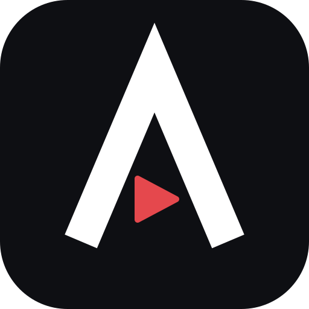

<p align="center">
  
</p>

<h1 align="center">AnimeGoTV-Samsung</h1>

<p align="center">
  <b>English</b> · <a href="README.ru.md">Русский</a>
</p>

<p align="center">
  An unofficial <a href="https://animego.me">animego.me</a> client for Samsung Smart TVs (Tizen).<br>
  Watch anime with the remote — no browser, no typing the address, straight into “Continue watching”.
</p>

<p align="center">
  
  
  
</p>

> [!NOTE]
> This project is not affiliated with animego.me or its owners. It only talks to the site the same way the site's own web pages do, using your own account.

## Features

- **Home screen** — “Continue watching” with the episode, position and progress bar; a separate “Not watched for a while” row (14+ days); genres; new episodes of the season; ongoing and TOP-250.
- **Search, catalog and “My list”** — posters grid with endless paging; list tabs (Watching, Planned, Completed, On hold, Dropped, Rewatching).
- **Player** — starts from where you stopped; ±10 s seeking that speeds up while you hold the button; YouTube-style bar with buttons; seasons and episodes rows; next-episode countdown; opening skip.
- **Dubs** — remembered per title: a *main* dub and a *fallback* one used automatically when the main studio hasn't dubbed the new episode yet.
- **Quality** — Auto (HLS) or a fixed resolution, remembered.
- **Progress lives on the site** — position and “watched” marks are sent to animego.me, so your phone and PC see the same thing. The TV keeps only cookies, dub choices and a few dates.
- **Login is optional** — catalog, search and playback work as a guest; sign in with a built-in on-screen QWERTY keyboard.

## Requirements

- Windows with Git Bash, .NET SDK and the Tizen .NET workload (`Tizen.NET.Sdk`).
- `sdb` from Tizen Studio / tizen-tools (in Git Bash use `MSYS_NO_PATHCONV=1`).
- A Samsung TV on Tizen in the same network. Tested on UE50TU7140 (2020, Tizen 5.5).

## Install on your TV

1. **Enable developer mode on the TV:** open *Apps*, type `12345` on the remote, switch *Developer mode* to **On**, enter your PC's IP in *Host PC IP*, then restart the TV.
2. **Connect:**
   ```bash
   sdb connect <tv-ip>:26101
   ```
3. **Build, install and launch:**
   ```bash
   TV=<tv-ip>:26101 scripts/deploy.sh Release
   ```
4. On the TV: *Apps* → ⚙ → **AnimeGo** → *Add to Home*.

If a newer TV refuses the `.tpk`, raise `api-version` in `src/AnimeGo.Tv/tizen-manifest.xml`. After changing the icon, bump `version` and reinstall (`sdb uninstall ru.animego.tv` — this also clears the app's login).

## Development

```bash
dotnet test                               # Core tests on the PC
node scripts/devlog.mjs                   # receives debug lines from the TV
TV=<tv-ip>:26101 scripts/deploy.sh Debug  # Debug build sends DevLog to the PC
```

`DevLog.Host` in `src/AnimeGo.Tv/DevLog.cs` must point to your PC.

**Private fixtures.** `node scripts/login-sample.mjs` signs in from the PC exactly like the app does (asks for login and password in the console) and saves the page into `tests/AnimeGo.Core.Tests/Fixtures/private/`. That folder is git-ignored: it contains your account name and watch history. Tests that need it are skipped when it is missing.

## Project layout

| Path | What |
|---|---|
| `src/AnimeGo.Core` | Logic without UI (netstandard2.0, no NuGet): HTTP, login, parsers, models, progress rules |
| `src/AnimeGo.Tv` | The Tizen app: screens, player, on-screen keyboard |
| `tests/AnimeGo.Core.Tests` | xUnit tests on real site responses (`Fixtures/`) |
| `design/` | Mockups and the icon source |
| `research/samples` | Raw site responses used to build the parsers |
| `scripts/` | `deploy.sh`, `devlog.mjs`, `login-sample.mjs` |

Docs: [design spec](docs/superpowers/specs/2026-10-27-animego-tv-design.md) · [implementation plan](docs/superpowers/plans/2026-10-27-animego-tv.md) · [site API notes](API-findings.md) · [project rules & TV pitfalls](CLAUDE.md) (in Russian).

## Known limitations

- Kodik streams are not playable; CVH and AniBoom are used.
- The TV's native keyboard can't be used reliably from an app, so the app has its own.
- The first poster load after launch takes a few seconds (WebP is decoded on the TV), then posters come from the cache.
- Opening skip uses [aniskip](https://aniskip.com) timings when they exist; otherwise it learns from your first press on each title.
